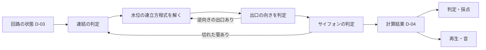

# アクア・ノーツ 処理設計（計算・判定・再生・出題）

版：基本設計 v0.1（2026-10-31、2026-11-01 要件定義書 v0.3 に合わせて更新）。正典は [要件定義書](../要件定義書_AQUA_NOTES.md) v0.3。本書は要件を実装できる形に翻訳したもので、要件と食い違う場合は要件定義書を優先する。【想定】は設計側の仮置きで、実装・試作で変わり得る。

本アプリにサーバーはないため、前作の「API設計」にあたる内容を本書にまとめる。すべての処理は端末のブラウザ内で行う。

## 1. 計算の全体像



計算は「落ち着いた後の状態」だけを求める（要件5.1）。途中の動きは再生側の演出で、計算結果に戻さない。

## 2. 数の扱い

- すべての数（泉の高さ、出口の口の高さ、水路の細さ、水位、流れる量）を**分数**で扱う。分子・分母は `BigInt`。浮動小数点は描画と発音の直前にだけ使う
- 流れやすさ g ＝ 1 ÷ 細さ。細さはゼロでない正の分数（要件5.1）
- 比較（音階に乗っているか、出口が逆向きか、入口が水から出たか）はすべて分数の完全一致・大小比較で行う
- 【想定】分数は約分して保持し、比較用の正規形を持つ。実装は `src/logic/fraction.js` に集約し、他の場所で四則演算を書かない

## 3. 部品の計算上の扱い

| 部品 | 計算上の扱い |
|---|---|
| 泉 | 水位が泉の高さHに固定された点 |
| 塔 | 水位が未知の点 |
| 出口 | 口の高さhに固定された外部への接続。流れやすさg_oを持つ。一方向（4.3） |
| 水路 | 2点を流れやすさgでつなぐ。向きは持たない（流れの向きは計算で決まる） |
| 太さを変えられる水路 | 段ごとの細さを持つ水路。選ばれた段の値を使う |
| 排水口（後続） | 塔から地面（高さ0）へ抜ける出口として扱う。段ごとの流れやすさを持つ。一方向 |
| サイフォン | 開通していて切れていない間だけ水路として扱う（4.4） |
| 水門 | 開いた状態では水路、閉じた状態では無いものとして、2回計算する（5.3） |

- 【想定】管の端は塔の底につながる（ふつうの管は常に水につかっている）。サイフォンだけは入口の高さ（塔の底からの高さ）を持ち、面の定義で決める。自由作成では既定値を使う（第8章 要確認）
- 管の通り道の高さ（持ち上げた部分を含む）は流れの計算に使わない。使うのは「サイフォンになるか」の判定（4.4）と描画だけ
- 【想定】塔の高さは、その面の泉の高さ以上にする。水位は泉の高さを超えないため、塔からあふれることはない

## 4. 計算の手順

### 4.1 連結の判定

泉から、使える水路（サイフォンは開通かつ切れていないもの、水門は開いた状態のもの）をたどって行ける塔だけを計算の対象にする。たどれない塔は「空」とし、計算から除く（要件5.1 表の3行目）。出口は水を入れないので、出口からはたどらない。

### 4.2 水位の連立方程式

対象の各塔iで、出入りする流れの合計がゼロになる式を立てる（第1法則）。

```
Σ_j g_ij (v_i − v_j) + Σ_(有効な出口o) g_o (v_i − h_o) = 0
```

泉は v = H として右辺へ移す。分数のガウスの消去法で解く。【想定】面の規模（塔は十数個以下）ではこの方法で十分速い。

出口につながっていない連結成分では、解は全塔 v = H、流れはすべてゼロになる（要件5.1 表の2行目）。式を特別扱いしない。

### 4.3 出口の向き（一方向）

出口は水を出すだけで、入れない（要件5.1）。次の手順で、矛盾のない答えを1つに決める。

1. すべての出口を「有効」として4.2を解く
2. 有効な出口のうち v_i < h_o（水が入る向き）のものを「無効」にし、無効な出口のうち v_i > h_o のものを「有効」に戻す
3. 有効な出口の組が変わらなくなるまで2を繰り返す

【想定】この問題は「流れのエネルギーを最小にする」凸の問題と同じ形で、答えは1つに決まる（推測を含む）。繰り返しが必ず終わること・答えの一意性は、テストで**出口の有効・無効のすべての組み合わせを総当たりした結果**と突き合わせて確かめる（tasks.md T-01）。総当たりと食い違う例が見つかったら、その例を残して方法を見直す（C-03により、難しさを理由に出口の一方向を外さない）。

v_i = h_o のときは、その出口の流れはゼロで、有効・無効どちらでも同じ結果になる。【想定】表示上は「届いていない」とする。

### 4.4 サイフォンの判定

- サイフォン候補の管：通り道の最も高い点が、上流側の塔の水位より上にある管。課題の面では面の定義で決め、出題の検査で確かめる。自由作成では毎回この条件で判定する
- 開通していないサイフォンは、計算上ないものとする
- 4.1〜4.3で求めた結果で、開通しているサイフォンの上流側の塔の水位が、その入口の高さより低ければ、そのサイフォンを「切れた」にする
- 切れた管があれば、それを除いて4.1からやり直す。切れた管は戻らないので、繰り返しは最大でサイフォンの本数＋1回で終わる（要件5.2）
- 切れたサイフォンの桶は手元に戻す（要件5.2）
- 上流側：その管で流れが来る側の塔。流れがゼロの場合は、水位の高い側

自由作成でのサイフォン候補の決め方（要件5.2、2026-11-01 確定）：

1. 最初は、呼び水をしていない管もふつうの管として4.1〜4.3を解く
2. 呼び水をしていない管のうち、通り道の最も高い点が上流側の塔の水位より上にあるものを「サイフォン（未開通）」にする。未開通のサイフォンは山に空気がたまっている扱いで、計算に入れない
3. 一度サイフォンにした管は、その実行の間ふつうの管に戻さない。上流の水位が山より高くなっても、勝手には開通しない
4. 新しくサイフォンにした管があれば、4.1からやり直す

管がサイフォンになる向きにしか変わらないので、繰り返しは最大で管の本数＋1回で終わる。切れる判定（上の箇条）と合わせても、どちらも一方向にしか変わらないため必ず終わる。本物の水で起きる、あふれた水による自動の開通や、開通と切れの繰り返しは扱わない（時間で水位が変わる現象のため、要件3.5の対象外）。

【想定】呼び水をした管で、計算後に山が上流の水位より下になったものは、ふつうの管として流れる（呼び水は流れる量に影響しない）。

### 4.5 計算結果

計算結果（D-04）には次を持たせる。

- 各塔：状態（空／水あり）、水位、音階に乗っているか、近い目盛りの上か下か、入る量の合計と出る量の合計（第1法則の確認用。水ありの塔では等しい）
- 各水路：流れる量（向き付き）、状態（ふつう／サイフォン開通／サイフォン切れ／未開通）、両端の水位の差と細さ（流れる量＝差÷細さの確認用）
- 各出口：流れる量、指定量との比較（足りない／ちょうど／多い）、虹の有無
- 切れたサイフォンの順番（再生用）
- 計算の繰り返し回数（検証用）

## 5. 判定と採点

### 5.1 音階に乗っている

目盛りの間隔をs、基準の水位をL0とする（面ごと、【想定】試作で決める）。水位vについて (v − L0) ÷ s が整数のとき「音階に乗っている」。分数で完全一致を判定する（要件5.5、許容幅なし）。

近い目盛りの上か下か：(v − L0) ÷ s の小数部で判定する。ちょうど真ん中は【想定】「上」とする。

### 5.2 音の高さ

目盛りの番号 n ＝ (v − L0) ÷ s。水位が高いほど低い音にする（グラスハープ、要件5.5）。

```
半音の番号 m = m0 − n        （m0 は面ごとの基準）
周波数 f = 440 × 2^((m − 69) / 12)   （平均律、ラ＝440Hz を MIDI番号69とする）
```

音階に乗っていない水位では、nを小数のまま計算した周波数を鳴らす（ずれた音になる）。【想定】使う音域・m0は試作で決める。

### 5.3 クリアの判定

- 各出口の流れる量が指定量と完全に一致すれば、その出口は成立
- すべての出口が成立すればクリア
- 水門のある面では、開いた状態と閉じた状態の両方で計算し、両方で全出口が成立すればクリア。それぞれの状態の結果を保持し、外れた状態を示す
- サイフォンが切れても、それだけでNGにしない。切れた後の結果で判定する

### 5.4 採点

- 前作と同じく、満点の答えと部分点の基準は出題ごとに事前に計算して持つ（D-02）。端末では照合するだけ
- 基本の観点：使った水路の本数（少ないほど高評価）
- テーマの観点（要件5.7の表）：テーマの観点を満たしたうえで本数が少ないものが100点
- 試した回数・時間は使わない
- 部分点の式（2026-11-01 確定）：前作の `src/core/evaluation.js` の `timeScore`（50 × (かかった時間 ＋ 満点の時間) ÷ かかった時間）の時間を本数に置き換える

```
点数 = 50 × (使った本数 + 満点の本数) ÷ 使った本数   （＝ 50 ＋ 50 × 満点の本数 ÷ 使った本数）
```

- 使った本数が満点の本数より少ないとき（テーマの観点で満点より劣る答えで起きる）は、比を1とする
- 100点は満点のつなぎ方（D-02）だけ。満点以外で計算値が100点になる場合は 9999/100（99.99点）にする
- 満点以外は、指定量を満たしていれば点数にかかわらずクリア。NGは0点。分数で持ち、表示は小数2けた（前作の `displayScore` と同じ）
- テーマの観点が2段階ある面（桶の数 → 本数など）も同じ式。テーマの観点は、出題の検査で満点のつなぎ方を決めるのに使う（2026-11-01 確定。前作の2段階の式 `timeHopScore` は前作でも提案中のため使わない）

## 6. 再生

### 6.1 水面が上がる順番

【想定】泉から各塔までの「流れのある水路をたどった道のりの長さ（描画上の長さ）」が短い順に、水面が上がり始める。流れのない連結成分（出口のない回路）も同じ順番で満ちる。

### 6.2 上限時間に収める

- 再生の対象：水面が上がる演出、サイフォンが切れる演出、水門を閉じる演出（要件5.4）
- 面の定義に上限時間 T を持たせる（D-01）。【想定】既定の速さで演出全体の長さを見積もり、T を超える場合は全体の速さを一律に上げて T に収める
- 和音とジングルは対象外

### 6.2.1 結果の間合い（前作の考え方に合わせる、要件NF-002）

前作は「すぐ出す」より「余韻と少しの待ち」がしっくりくると調整を重ねた（前作の点検記録 2026-10-16 success-timing、2026-10-24 outcome-delay・shorter-ending・result-timing-settings）。扱いは移すが、秒数は前作の鐘の余韻（約2.6秒）に合わせて決めた値なので、そのまま使わない。【要確認】本作の秒数は、グラスハープの余韻の長さが決まってから試作で決める（要件Q-04）。前作の秒数は出発点の参考。

| 項目 | 前作の値・扱い（秒数は参考） | 前作の置き場所 |
|---|---|---|
| ジングルの開始 | 結果確定の0.7秒後 | `src/ui/audio.js` `SUCCESS_JINGLE_DELAY_SECONDS` |
| 結果カードの表示 | 動きが終わってから1.6秒後（クリア・失敗とも初期値。0.39.0では2.7秒で、鐘の余韻に合わせて調整を重ねた） | `src/ui/result-timing.js` `DEFAULT_RESULT_TIMING` |
| 調整用の設定 | クリアと失敗を別々に0〜5秒・0.1秒刻み。端末に保存し、次の再生から使う。回路・成績の保存とは混ぜない。再生ごとに値を固定 | 同上、設定画面「結果カードのタイミング（調整用）」 |
| 待ちと計算 | 待ちは計算の時間・記録に加えない | `src/ui/end-wait.js` |
| 自動で進むとき | 音・余韻・演出を途中で切らず自然に終える。カードが演出に重ならない | 点検記録 2026-10-24 shorter-ending |
| 停止を押したとき | 待たずに即時に止めて編集へ戻る | 同上 |
| 一度出た結果音 | 結果を開き直しても鳴らし直さない | `src/ui/outcome-sound.js` |

本作での当てはめ：「動きが終わった時」は、水面の動き（上がる・サイフォンが切れる・水門）が落ち着いた瞬間とする。落ち着いた和音はその瞬間に鳴り始め、余韻を聞かせてから結果カードを出す。秒数は定数1か所にまとめ、調整用の設定から変えられるようにして、試作で詰める。前作はカードと同時に編集へ戻るが、本作は結果表示中に塔をスワイプして聞き直すため、カードの後も結果表示中にとどまり、停止で編集へ戻る（要件5.3、2026-11-01 発案者が確定）

### 6.3 再生の順序

1. 水面が上がる（音は控えめに、水位に合わせて下がる）
2. サイフォンが切れた順に、泡→水面が下がる→音が上がる
3. 水門の面：開いた状態で落ち着く→和音→水門を閉じる→水位が動く→閉じた状態で落ち着く
4. 落ち着いた和音を一定時間鳴らす（【想定】長さは試作で決める）
5. 結果（虹・表示・ジングル）

## 7. 出題の生成と検査

前作の方式（`scripts/generate-*-challenges.js`）に合わせ、出題は事前にスクリプトで作り、検査済みの数値だけをアプリに入れる。

### 7.1 生成

- 面ごとに、変えてよい数値の範囲（水路の細さ、出口の指定量、泉の高さ、桶の数など）を定義する
- 【想定】乱数の種を固定して候補の数値を作り、7.2の検査をすべて通ったものだけを採用する
- 採用数は各面8つ（前作と同じ、2026-11-01 確定）。8つを、満点のつなぎ方が同じものごとの「系統」に分け、系統を2つ以上にする（前作の `random-variants.js` は2系統×4）
- 指定量は「満点のつなぎ方で計算した流れる量」から決める

### 7.2 検査（C-04）

すべての許可されたつなぎ方（結べる道の選び方、太さの段、呼び水の選び方）を総当たりで計算し、次を確かめる。

| 検査 | 内容 |
|---|---|
| 満点の一意性 | 100点になるつなぎ方がちょうど1通り |
| 部分点 | 100点以外でクリアになるつなぎ方が1つ以上ある |
| 音階 | クリアになるすべてのつなぎ方で、全部の塔が音階に乗っている（要件13章 Q の申し送り） |
| サイフォン | サイフォン候補の管が、面の定義どおりに決まる。25〜30面では、どのつなぎ方でもサイフォンが切れない |
| 範囲 | 水位が塔の高さ以下。音の高さが決めた音域に収まる |
| 再生 | 演出が上限時間に収まる（6.2） |
| 系統 | 面の8つの出題が2つ以上の系統に分かれ、同じ系統の出題は満点のつなぎ方が同じ、違う系統では違う |

### 7.4 抽選（端末）

前作の `src/content/challenge-draw.js` に合わせる（2026-11-01 確定）。

- お試し（1〜6面）は固定の出題
- 面を選んだときは、直前にその面で出た出題と違う系統から抽選する。直前の出題がなければ8つから抽選する
- 「もう一度」「配線クリア」では同じ出題を保つ
- 直前の出題はアプリを開いている間だけ覚え、端末に保存しない
- 検査済みの出題がない、または面の内容版と合わない場合は、出題せずに理由を示す（C-04）

検査の結果（満点のつなぎ方、部分点の基準、期待される水位）を出題データ（D-02）に保存し、アプリのテストでも同じ結果になることを確かめる。

### 7.3 総当たりの規模

【想定】課題の面は結べる道の本数を絞り、総当たりが数十秒以内に終わる規模にする。前作でも候補の本数を面ごとに絞って全配線を検査していた。規模が大きすぎる面は、面の設計を見直す（検査を省かない）。

## 8. 要確認（設計で残るもの）

| ID | 内容 | 決める時点 |
|---|---|---|
| LD-01 | サイフォンの入口の高さ（面の定義値、自由作成の既定値） | 試作 |
| LD-02 | 自由作成でサイフォン候補が計算で変わる配置の扱い | 解決（2026-11-01）：4.4のとおり。一度サイフォンにした管はその実行の間戻さない |
| LD-03 | 目盛りの間隔 s、基準 L0・m0、音域 | 試作 |
| LD-04 | 部分点の式（前作に合わせる） | 解決（2026-11-01）：5.4のとおり |
| LD-05 | 水面が上がる順番の決め方（6.1の【想定】）の見え方 | 試作 |
