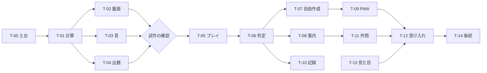

# アクア・ノーツ 実装順と要件対応

版：基本設計 v0.1（2026-10-31、2026-11-01 要件定義書 v0.3 に合わせて更新）。正典は要件定義書 v0.3。タスクの分け方・順番は【想定】で、変えてよい（0章B区分、記録する）。各タスクの完了条件・検証方法は削らない。

## 前提（仮置き）

- 【想定】試作は本番のリポジトリ（gerupon-lgtm/aqua）で作り始め、そのまま育てる（T-01〜T-04、T-12の一部が試作）
- 【想定】前作の部品（音、PWA、タッチ補助、更新、ファイル入出力、保存）は、必要な分だけ移す。移した部品も本作のテストで確かめる

## 1. 要件との対応表（正典）

画面IDは [screens.md](screens.md)、データIDは [data-model.md](data-model.md)、処理は [logic-design.md](logic-design.md) を参照。空欄の行は設計漏れとして扱う。

| 要件ID | 機能 | 画面 | 処理（logic-design） | データ | タスク | 版 |
|---|---|---|---|---|---|---|
| F-001 | 課題の面選び・出題の抽選 | S-01・02・03 | 7章（抽選は7.4） | D-01・02・06 | T-04・T-06 | 初期版 |
| F-002 | 配管の結線と取り外し | S-03・07 | ― | D-03 | T-05 | 初期版 |
| F-003 | 流れの計算 | S-03・07 | 2〜4章 | D-01〜04 | T-01 | 初期版 |
| F-004 | 実行の再生 | S-03・07 | 6章 | D-04 | T-05 | 初期版 |
| F-005 | サイフォンと桶 | S-03・07 | 4.4 | D-01〜04 | T-01・T-05 | 初期版 |
| F-006 | サイフォンが切れる判定と演出 | S-03・07 | 4.4、6.3 | D-04 | T-01・T-05 | 初期版 |
| F-007 | 手押しポンプ | S-03 | 4.4（汲める条件） | D-01・03 | T-14 | 後続 |
| F-008 | 太さを変えられる配管 | S-03・04・07 | 3章 | D-01・03 | T-05 | 初期版 |
| F-009 | 排水口 | S-03・04・07 | 3章 | D-01・03 | T-14 | 後続 |
| F-010 | 水門 | S-03 | 3章、5.3、6.3 | D-01〜04 | T-05 | 初期版 |
| F-011 | グラスの音 | S-03・05・07 | 5.2、6.3 | D-01・04 | T-03 | 初期版 |
| F-012 | グラスの表示 | S-03・07 | 5.1 | D-04・09 | T-02 | 初期版 |
| F-013 | 出口の噴水盤 | S-03・05 | 5.3 | D-04 | T-02・T-06 | 初期版 |
| F-014 | 判定と採点 | S-05 | 5.3・5.4 | D-02・04 | T-06 | 初期版 |
| F-015 | 課題の成績の自動保存 | S-02・05 | ― | D-06 | T-06 | 初期版 |
| F-016 | 自由作成の配置と接続 | S-07 | 4.4（自由作成の判定） | D-03 | T-07 | 初期版 |
| F-017 | 自由作成の保存・読み込み・名前変更・削除 | S-08 | ― | D-07 | T-07 | 初期版 |
| F-018 | 自由作成の見本とお題 | S-07 | 5.1 | D-01・07 | T-07 | 初期版 |
| F-019 | チュートリアルと水の精霊 | S-01・09・10 | ― | D-08 | T-08 | 初期版 |
| F-020 | 消音でも分かる表現 | S-03・05・07 | ― | D-04 | T-02・T-12 | 初期版 |
| F-021 | 登録不要の一般公開 | S-01 | ― | D-12 | T-00・T-09 | 初期版 |
| F-022 | PWA・通信なしでの利用 | S-11 | ― | D-12 | T-09 | 初期版 |
| F-023 | 回路のファイル書き出し・読み込み | S-08 | ― | D-10 | T-07 | 初期版 |
| F-024 | 実行記録 | S-06 | 4.5 | D-05・11 | T-10 | 初期版 |
| NF-001 | 正確性・準拠 | S-03 | 2〜5章、7章 | D-01〜04 | T-01・T-03・T-04 | ― |
| NF-002 | 性能・応答 | S-03・05 | 6.2 | D-01・04 | T-05・T-06・T-12 | ― |
| NF-003 | データ保護 | S-05・08 | ― | D-06・07・10 | T-06・T-07 | ― |
| NF-004 | セキュリティ・プライバシー | 全画面 | ― | D-06〜08 | T-00・T-09 | ― |
| NF-005 | 操作性・消音・縦横 | 全画面 | ― | D-03 | T-02・T-05・T-12 | ― |
| NF-006 | 運用・保守（版数・© 表示） | S-01・11 | ― | D-12 | T-00・T-09 | ― |
| NF-007 | オフライン | S-11 | ― | D-12 | T-09・T-12 | ― |
| NF-008 | 拡張性 | ― | 3章 | D-01 | T-01・T-14 | ― |

## 2. タスク

### T-00 リポジトリと公開の土台

- 内容：新しいリポジトリ gerupon-lgtm/aqua を作る（作成は発案者が行う）。`package.json`（版 0.1.0）、ビルド・テスト・構文確認・開発用サーバーのスクリプト、AGENTS.md と docs、GitHub Actions、Cloudflare の自動公開、公開アドレス aqua.sikumilab.com
- 完了条件：空のアプリが aqua.sikumilab.com に公開され、画面に版数と「© SIKUMI LAB」が出る。版数の正典は `package.json` の1箇所で、画面・資材の名前・キャッシュの値がすべて同じ値になる
- 検証方法：版の同値検査スクリプト（前作の `scripts/check-release.js` 相当）で、`package.json`・画面・資材の名前の版が一致することを確認。版を変えずに資材だけ変えた場合に検査が失敗することも確認。サーバーへ回路・成績を送る通信がないことをブラウザの通信記録で確認

### T-01 流れの計算（試作）

- 内容：分数の計算、連結の判定、連立方程式、出口の一方向、サイフォンの判定、計算結果（logic-design 2〜4章）
- 完了条件：手計算の例（直列、並列、出口なし、泉につながらないグラス、出口が高すぎる、サイフォンの開通・未開通・切れる、水門の2状態）がすべて一致する
- 検証方法：
    - 手計算の例を固定値のテストにする
    - 出口の有効・無効の全組み合わせを総当たりした結果と、4.3の繰り返しの結果を、ランダムに作った小さな回路（数百件以上）で突き合わせる。食い違いがあれば例を保存して失敗にする
    - 別の方法（【想定】浮動小数点の連立方程式の解き方）との近似一致を確かめる
    - サイフォンの判定の繰り返し回数が、サイフォンの本数＋1以下であること
    - 自由作成の判定（logic-design 4.4）：水位によってサイフォンかどうかが変わる配置（ふつうの管として流すと山が水面より上になり、外すと水面が山より上になる例）で、計算が終わり、その管が未開通のサイフォンのままになること。ランダムな自由作成の回路でも、繰り返しが管の本数＋1回以下で終わること
    - 異常系：細さゼロ・負の値・つながっていない部品・グラスのない回路を渡したとき、例外で止まらず決めた扱いになること

### T-02 断面の盤面とグラスの表示（試作）

- 内容：グラス・管・出口の描画、目盛り、水の色、光、揺れ、前回の水面の線、サイフォンの状態の区別、噴水盤と噴水・虹、拡大・移動
- 完了条件：計算結果どおりの水位・状態が、色だけでなく形・印でも分かる。消音でも結果が分かる
- 検証方法：Pixel 6a（Android Chrome）と iPhone XR（Safari）の実機で、縦横両方の画面を撮影し、グラスの幅・目盛り・揺れ・色の差が判別できるかを発案者が確認（要件Q-07）。動きを減らす設定で揺れが止まること。ブラウザの自動確認で、狭い幅（320×480）でもはみ出さないこと

### T-03 グラスの音（試作）

- 内容：グラスハープ式の音、平均律（ラ＝440Hz）、水位から音の高さ、落ち着いた和音、上がる間の控えめな音、スワイプで聞き直し、消音（前作の音の部品を移す）
- 完了条件：水位が目盛りに乗ったとき、平均律の周波数どおりに鳴る。水位が高いほど低い音
- 検証方法：周波数の計算を固定値のテストにする（例：目盛り番号から期待周波数）。実ブラウザで録音した信号の基本周波数を確かめる（前作の信号検査の方法を移す）。消音・停止で音が止まること。実機での聴感は発案者が確認

### T-04 出題の生成と検査（試作は少数の面）

- 状況（2026-11-01）：生成・検査・抽選を実装。7〜30面に検査済みの出題が8つずつ（2系統×4）。再生の上限時間の検査は、上限の秒数が未定のため未実装

- 内容：生成スクリプト、総当たりの検査（logic-design 7章）、出題データの出力
- 完了条件：試作では、お試しと7〜12面のうち数面で、検査をすべて通る出題を作れる。全面では1〜30面すべてに出題がそろう
- 検証方法：検査の各項目（満点の一意性、部分点、音階、サイフォン、範囲、再生、系統）が、わざと条件を崩した出題で失敗することを確かめる。生成を同じ種で2回実行して同じ結果になること。アプリのテストで、出題データの期待水位と計算結果が一致すること

### T-05 プレイの流れ

- 内容：結線・取り外し、呼び水と桶、太さの段、水門、編集中→実行中→結果表示中→停止の状態遷移、届いた順の再生、上限時間、サイフォンが切れる演出、水門の連続表示
- 完了条件：編集中・実行中・結果表示中で、要件5.3の表どおりに操作の可否が切り替わる。どのつなぎ方でも演出が上限時間内に収まる
- 検証方法：状態ごとに禁止の操作を試し、受け付けないこと。桶が、呼び水の取り消し・管を外す・サイフォンが切れたときに戻り、使い切って進めなくならないこと（AC-05）。出題の全つなぎ方で再生時間を計り、上限以下であること（AC-03）。実行中の回転・画面の切り替えで状態が壊れないこと

### T-06 判定・採点・結果・成績

- 内容：クリアの判定、テーマの観点と本数による採点、部分点（前作の式を移す）、結果画面、ジングルと結果カードの間合い（余韻を聞かせて少し待つ、調整用の設定つき。秒数は試作で決める。logic-design 6.2.1）、出口の過不足表示、成績の自動保存、出題の抽選
- 完了条件：100点・クリア・NGが要件5.6の表どおりに出る。成績は低い点数・NGで上書きされない
- 検証方法：出題データの満点のつなぎ方で100点、部分点のつなぎ方でクリア、届かないつなぎ方でNGになること。ジングルの開始と結果カードの表示時刻を計測し、試作で決めた値どおりであること。調整用の設定でクリアとNGの待ちを別々に変えられ、再生中に変えてもその回の値が動かないこと。自動で進むときに和音の余韻・ジングルが途中で切れず、停止では即時に止まること（AC-08）。保存に失敗する状況（保存領域が使えない）でも、結果が表示され、未保存と再試行が案内されること。内容版が変わったとき旧成績が消えないこと。抽選（logic-design 7.4）：選び直しで直前と違う系統が出ること、「もう一度」「配管クリア」で同じ出題を保つこと、お試しは固定であること。部分点の式（logic-design 5.4）を、満点の本数と使った本数の組み合わせの固定値のテストにすること（テーマの観点で劣り本数が満点以下の答えが99.99点になる例を含む）

### T-07 自由作成

- 内容：パーツの追加と配置（初期版のパーツだけ、泉は1つ）、管のつまみ、自動のサイフォン判定、太さの選択、桶の使い放題、見本2つ（基本／サイフォンと桶）とお題、10枠の保存・読み込み・名前変更・削除、回路ファイル
- 完了条件：見本から始めて、回路を作り、流し、保存して、読み込み直して同じ結果になる。お題を達成すると演出と印が出る
- 検証方法：満杯時の置き換え・削除・読み込み時の編集中の扱いが、確認なしに起きないこと（C-01、AC-07）。不正な回路ファイル（形式違い、値の不正、壊れたファイル）を読み込ませて、読み込まず理由が出ること。保存に失敗しても編集中の回路が残ること

### T-08 チュートリアルと水の精霊、説明

- 内容：初回の体験型の案内、スキップ、再閲覧、完了・スキップの記録、パーツの説明、遊び方
- 進み具合（2026-11-01、v0.10.0）：お試し1〜6面の案内・予想の問い・答え合わせ・ふりかえり・スキップ・記録を実装（screens.md S-09）。v0.11.0 で練習面（画面の見方と操作の案内）を追加。残り：タイトルからの入口、パーツの説明・遊び方（S-10）、自由作成の案内、精霊の見た目（T-13）。実機での確認は未
- 完了条件：初めての起動からお試し1面のクリア（噴水とクリアのジングル）まで、案内に従って到達できる（要件3.4）
- 検証方法：初回起動の流れを自動確認で最後まで通す。スキップ後に自動で再表示されないこと。再閲覧後に元の画面へ戻ること

### T-09 PWA・更新・公開

- 内容：資材の保持、通信なしでの起動、更新の案内、版数と「© SIKUMI LAB」の表示（前作の仕組みを移す）
- 完了条件：初回の資材取得後、通信なしで課題・自由作成・音・保存・ファイル入出力が使える
- 検証方法：通信を切って再起動し、全機能を確認。新しい版を公開して、更新の案内が出て、成績と保存した回路が残ること。前作で起きた更新時のタイムアウトの対策（前作の点検記録）を移したうえで確認

### T-10 実行記録

- 内容：記録の表示と書き出し（D-05、D-11）
- 完了条件：実行ごとに、各配管の流れる量・各グラスの水位・サイフォンの状態・判定が見られ、ファイルに書き出せる。端末には残らない
- 検証方法：書き出したファイルが JSON として読めて、実行に使った回路と面・出題・内容版が入っていること。分析用の項目で、水ありの各グラスの入る量と出る量の合計が等しく、各配管の流れる量が両端の水位の差÷細さと一致すること（未開通・切れたサイフォンは流れる量ゼロ）。再起動後に記録が残っていないこと

### T-11 1〜30面の作問

- 状況（2026-11-01）：1〜30面の定義がそろい、7〜30面（お試し以外の24面）に検査済みの出題が8つずつ（2系統×4）。お試し5「近道と回り道」を追加。配置の点検（グラス・噴水盤・壁の重なり、サイフォンの脚、同じ段の管）を tests/layout.test.js に追加。発案者の試遊による難しさと流れの確認は未実施

- 内容：面の定義、出題の生成と検査、試遊
- 完了条件：1〜30面すべてに検査済みの出題がそろい、25〜30面ではどのつなぎ方でもサイフォンが切れない
- 検証方法：T-04の検査を全面で実行。発案者が試遊して難しさと流れを確認

### T-12 実機確認と受け入れ

- 内容：要件11章の受入基準 AC-01〜10 の確認
- 完了条件：第9章の全端末で、縦横両方・通信なしで遊べる。手元にない端末は不足として記録する（対象から外さない）
- 検証方法：Pixel 6a・iPhone XR・Windows（Chrome・Edge）は実機。macOS・iPad は手元の有無を確認し、無ければ不足を記録。発案者が試作と初期版を遊び、成功基準（法則の入り口を体感できるか）を判断する

### T-13 見た目の確定

- 内容：色の値、淡い金色の差し色、噴水盤と虹、水の精霊、ロゴ（白と青）、静けさの表現、書体の見直し
- 持ち越した相談（試作中に発案者から。2026-11-01）：
    - 泉が泉に見えるか（動きを見てから相談）
    - 結果表示で盤面が縮む。縮むこと自体は受け入れる（2026-11-01 発案者）。ただし一度に切り替わるので、滑らかに縮む遷移にする
    - 条件の行が2行になる面（受け皿2つ・桶あり）で、盤面がほかの面より小さくなる（v0.10.3 で対応：条件の欄の高さを、その端末・画面幅で全部の面を測った一番高いものにそろえる。見た目の詰め方は T-13 で見直す）
    - 条件の欄の配置を前作 prism の条件カードに近づける（2026-11-01 発案者。面の名前・出題・指定・桶・本数の置き場所を決め直し、どの面でも同じ行数に収めて、条件の短い面に空きが出ないようにする）
        - 参考画面：docs/reference/prism-v0.100.0-q3-layout.png（前作 v0.100.0、スマホ縦、2026-11-01 発案者提供）。上から順に、ロゴと「記録・音・メニュー」／面の切り替え（‹ 面の名前と所属 ∨ ›。番号のタブの列はない）／条件カード（「クリア条件」と「詳しく ⓘ」、条件の一文、資源の行「配線 上限3本 使用0本 残り3本」）／盤面と、その下の補助の行（クリア・補助・秒数・拡大縮小）／状況の一行／下の3つのボタン（停止・鐘を鳴らす・次の動き）。本作では条件の一文を「噴水盤に 2 届ける」、資源の行を「桶 残り・配管 n 本」に当てはめる案
    - 結果で虹が出ると「口の高さ」の文字にかぶる（お試し4）
    - 深い段の管の縦の部分が、浅い段の管の横の部分と交差して見える。交差点ではタップでどちらを選ぶか決まらない（お試し2のP1とP3など）
    - 配管が重なって、行き先が見えないものがある（8面「間のグラスを通って」：泉の下から右へ延びる管が、ほかの管の縦の部分と重なる。2026-11-01 発案者がスマホで確認）
    - 噴水盤の「指定 3」などの普通の文字を、分かりやすいバッジにする（2026-11-01 発案者）
    - 噴水盤の口の細さ「口 太1」の見せ方（v0.9.5 で器の正面に仮置き。2026-11-01 発案者）
    - 盤面の文字で示している情報（泉、口 太1、指定 2、口の高さ、水門、空 など）を、きれいなバッジにする（2026-11-01 発案者。絵の発注書に記載する）
    - 絵の発注書（docs/assets.md）：画面の骨組み（v0.12.0）で置き場所が決まったので、背景（初期版5〜6枚・後続4枚・タイトル1枚）、水の精霊、ロゴ、盤面のバッジなどの枚数・大きさ・透過・置き場所・世界観・生成の指示文の下書きを書く。絵は Codex の画像生成で作る（前作と同じ。2026-11-01 発案者と分担を決定）
    - 水の精霊の姿：前作は案内のときだけ、案内の行の左に人型の星の精霊の画像（38×56px、docs/assets.md の採用原本から透過PNG）を出している。本作も案内のときだけ人型の水の精霊を出す。いまは仮の小さなしずく（v0.10.0〜）
    - 面の始めに課題を光らせて知らせる。前作 prism は面の開始時に条件カードの背景と枠を1.1秒、一度だけ金色に明るくする（0.95.0。位置・寸法・文字・音・操作は変えない。動きを控える設定では点滅せず色だけ）。本作では条件の行と噴水盤の指定量（上のバッジ）に当てはめる案（2026-11-01 発案者）
- 完了条件：実画面で候補を見比べ、発案者が選んだものを screens.md のデザイントークンへ反映
- 検証方法：対象の画面幅（スマホ縦・横、PC）で実画面のスクリーンショットを撮り比較。モックの承認だけで完了にしない

### T-14 後続（31〜54面）

- 内容：手押しポンプ（F-007）、排水口（F-009、自由作成での実行中操作を含む）、泉が2つ、逆向きの流れの見せ方、総まとめと水門（1面2個まで）、自由作成での解禁、後続のパーツを使う自由作成の見本（お題つき）の追加
- 完了条件・検証方法：初期版と同じ基準（T-01・T-04・T-05・T-06）を、追加した部品と面に適用する

## 3. 実装順【想定】

試作の確認（図の「試作の確認」）で、発案者が見た目と音、法則の入り口の体感を確かめてから T-05 以降へ進む。
