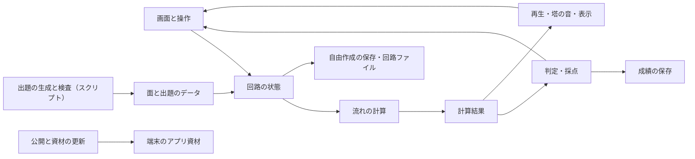

# アクア・ノーツ 基本設計サマリ

版：基本設計 v0.1（2026-10-31、2026-11-01 要件定義書 v0.3 に合わせて更新）。入力は要件定義書 v0.3。人が判断の根拠を確かめるための要約で、実装の詳細は `AGENTS.md` と `docs/` を参照する。設計全体の承認、実装・公開の着手許可とは区別する。

## 1. 判断したこと

| 項目 | 決定 | 根拠 |
|---|---|---|
| リポジトリ | 新しく作る（gerupon-lgtm/aqua） | 発案者の選択。公開アドレス（aqua.sikumilab.com）も別で、配信と版の管理を分けられる |
| 前作のコード | 新しく書き、前作の部品は必要な分だけ移す | 発案者の選択。計算と盤面は前作と根本から違う。音・PWA・タッチ補助・更新などは実機で直してきた部品 |
| 試作 | 本番のリポジトリで作り始め、そのまま育てる | 発案者の選択。確かめた計算や部品をそのまま使える |
| 技術の構成 | 前作と同じ（JavaScript・追加ライブラリなし、SVG、Web Audio、Nodeのスクリプト、GitHub＋Cloudflare） | 発案者の選択。操作感と細部を前作に合わせる方針とも合う |
| 実装に使うAI | 入口は AGENTS.md | 前作の作業指示が AGENTS.md で、要件定義書の作成者も Codex だったため |
| 計算 | 分数で解く。出口の向きは繰り返しで決め、総当たりと突き合わせる。サイフォンは切れる管がなくなるまで | 要件の完全一致・出口の一方向・判定が必ず終わることを守るため |
| 出題 | 前作と同じく事前生成・総当たり検査。本作は「音階に乗る」検査を追加 | C-04。端末では検査済みの出題を選ぶだけにする |

## 2. 全体構成

すべて端末のブラウザ内で動く。回路や成績をサーバーへ送らない（C-05）。

## 3. 要件との対応

全24機能と非機能8項目を、画面・処理・データ・タスクへ対応付けた表は [docs/tasks.md](docs/tasks.md) 第1章（正典）。空欄の行はない。

| 区分 | タスク |
|---|---|
| 試作 | T-00 土台、T-01 計算、T-02 盤面、T-03 音、T-04 出題（少数の面） |
| 初期版 | T-05 プレイ、T-06 判定、T-07 自由作成、T-08 案内、T-09 PWA、T-10 記録、T-11 作問、T-12 受け入れ、T-13 見た目 |
| 後続 | T-14（31〜54面、手押しポンプ、排水口、泉が2つ、総まとめ） |

## 4. 進言（技術的に難しい点）

検証の対象から外す提案ではない（C-03）。

- **出口の一方向とサイフォンの組み合わせ**：答えが1つに決まり、計算が必ず終わる見込みだが、証明ではなくテスト（総当たりとの突き合わせ）で確かめる
- **出題の生成**：「満点が1通り」「部分点がある」「クリアのつなぎ方で全塔が音階に乗る」を同時に満たす数値が見つかりにくい可能性がある。試作の段階で少数の面で試す
- **自由作成のサイフォン**：水位によってサイフォンかどうかが変わる配置は、一度サイフォンにした管をその実行の間戻さない決まりで、必ず終わるようにした（2026-11-01 解決、logic-design 4.4）
- **スマホでの見え方**：細い塔の目盛り・揺れ・色の差。試作で実機確認

## 5. 残る要確認

| ID | 内容 | 決める時点・判断者 |
|---|---|---|
| LD-01 | サイフォンの入口の高さ | 試作・発案者 |
| LD-02 | 自由作成で水位によりサイフォンかどうかが変わる配置の扱い | 解決（2026-11-01）：一度サイフォンにした管はその実行の間戻さない |
| LD-03 | 目盛りの間隔・基準・音域 | 試作・発案者 |
| LD-04 | 部分点の式（前作に合わせる） | 解決（2026-11-01）：50＋50×満点の本数÷使った本数（比は1まで、満点以外は99.99点まで）。テーマの面も同じ式 |
| LD-05 | 水面が上がる順番の見え方 | 試作・発案者 |
| 要件Q-04〜15 | 要件定義書第13章のとおり | 各時点 |

## 6. 検証済みの事実

この時点で、アプリの計算・画面・音は未実装で、検証した事実はない。前作について、資料で確かめたこと（結果の間合いの考え方と調整用の設定、鐘の基準440Hz、技術構成、版の扱い。結果の間合いの秒数は前作の鐘の余韻に合わせた値なので本作では試作で決め直す。2026-11-01 に前作 0.100.0 のコードで確かめ直し、古い「操作に戻る2.7秒」を置換）だけを根拠として使った。前作のテスト実績を本作の証拠にしない。
