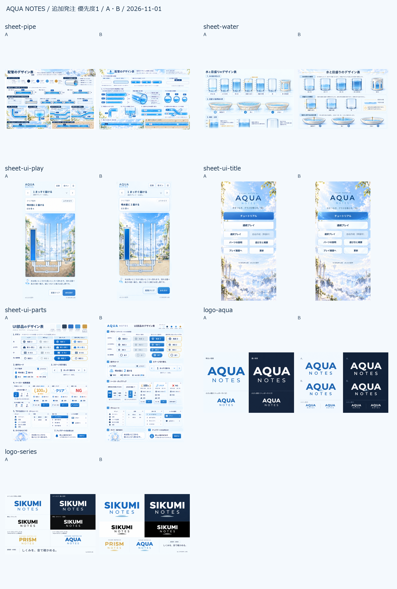

# AQUA NOTES 追加発注・優先度1

2026-11-01（日本時間）、Codexの組み込み画像生成。

**7資材すべてにA/B。主候補18枚＋部品表Bの予想3択の詳細1枚＝19枚。全案未採用。**

プレイ画面は各案にスマホ編集中・スマホ結果・PCの3枚。他の6資材は各2枚。別担当が実画面へ組み、発案者が実画面で見比べて選ぶ。

| 資材 | 比較・全文指示文 | 内容 |
|---|---|---|
| sheet-pipe | [README](../2026-11-01-sheet-pipe-addendum/README.md) | A 白い陶器 / B 青い縁のガラス管 |
| sheet-water | [README](../2026-11-01-sheet-water-addendum/README.md) | A 澄んだ水と細い光 / B 青い輪郭と反射 |
| sheet-ui-play | [README](../2026-11-01-sheet-ui-play-addendum/README.md) | A 陶器の縁 / B すりガラスの縁 |
| sheet-ui-title | [README](../2026-11-01-sheet-ui-title-addendum/README.md) | A 文字だけのロゴ / B 小さなしずく |
| sheet-ui-parts | [README](../2026-11-01-sheet-ui-parts-addendum/README.md) | A 白い陶器の面 / B すりガラスの面 |
| logo-aqua | [README](../2026-11-01-logo-aqua-addendum/README.md) | A 文字だけ / B しずくと波紋 |
| logo-series | [README](../2026-11-01-logo-series-addendum/README.md) | A 文字だけ / B 細い二重の響き |

## 保存先

`public/graphics/candidates-20261101-addendum/<資材ID>/` に指定寸法の19枚。原本・修正前・比較画像・指示文は `画面案/2026-11-01-<資材ID>-addendum/`。既存の `candidates-20261101` は書き換えない。

## 配置と採用の扱い

- スマホは公開版v0.13.0を390×844で確認し、[配置の測定値](layout-reference.json)を記録。配置と大きさを変える提案はしない。PCは追加発注書4-1に指定された前作の左盤面・右条件列を参照。
- 生成画像は見た目の見本。採用後は既存の配置と大きさを維持し、線・文字・図形・書式で作る。絵の中の文字や数値・画素位置を計算や画面寸法の正典にしない。
- A/Bは資材ごとの候補名。同じ記号を一括採用する決定ではなく、組み合わせも未確定。前回候補も採用済みとは扱わず、参照に使っただけ。
- **部品表Bの小さな予想欄は2択に見えるため、[Bの3択詳細](../2026-11-01-sheet-ui-parts-addendum/sheet-ui-parts-b-prediction-detail.png)が正しい構成を示す。**
- ロゴは画像を貼り付けず、実際のMontserratで再現する。副題は未確定。画面見本の版は参照版で、新しいアプリの版ではない。

## 確認済みと未確認

- 19枚の指定寸法・RGB・ファイルの読込・原本と修正前の保存・READMEの相対リンクを機械確認。加工は縦横比を保った寸法調整と余白補完のみ。減色なし。
- 配管の底接続、未接続と流れ、目盛り・光・空、タイトルの8ボタン、プレイの編集／結果／PC、主要なメニューと文言を目視点検し、誤生成箇所を修正。
- 画像の画素と実画面の矩形の完全一致、実フォント・小さい表示の可読性、実画面への組み込み、実機での見え方・操作は未検証。実画面で採用するときに確認する。
- プログラム・index.html・版・キャッシュの変更、コミット、GitHub送信、デプロイは行わない。この作業の追記は docs/assets.md の5章のみ。

## 採用欄

| 資材 | 採用 | 実画面で確認した日・条件 |
|---|---|---|
| sheet-pipe | 未確定 | 未確認 |
| sheet-water | 未確定 | 未確認 |
| sheet-ui-play | 未確定 | 未確認 |
| sheet-ui-title | 未確定 | 未確認 |
| sheet-ui-parts | 未確定 | 未確認 |
| logo-aqua | 未確定 | 未確認 |
| logo-series | 未確定 | 未確認 |

## 作業中に加わった境界の方針

追加発注書1-2に、白・透明の部品を濃い青の縁と淡い青の局所的な陰影で分ける指定が追記されたため、配管2枚・水2枚・プレイ画面6枚、計10枚へ反映済み。縁の色の制作値は#1d4f88前後。背景全体の暗化や部品の移動は行わない指示で画像を更新した。更新前も原本のhistoryに保持。

作業開始時との照合で src/ui/board.js と docs/assets-addendum.md に別途変更があったことを検出。この画像制作の保存処理は両ファイルへ書き込んでいない。変更はそのまま残し、追加発注書の上記指定だけを今回の絵へ反映した。
