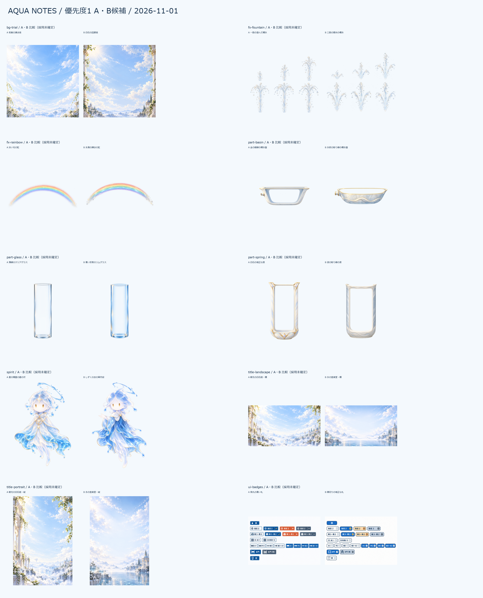

# AQUA NOTES 優先度1の画像候補

作成：2026-11-01（日本時間）。**全10資材IDに各2案。台座A/Bを含む候補原本は22枚（別途バッジBの修正前1枚も保持）。採用は全て未確定。**

発案者が実画面で見比べて選ぶための候補。取り込みは別担当が行う。公開画面への組み込み・実機での見え方・操作・16〜20pxでの札の読みやすさは未確認。

## 保存先と比較の入口

| 資材 | 比較案・全文指示 |
|---|---|
| bg-trial | [A/B・README](../2026-11-01-bg-trial/README.md) |
| fx-fountain | [A/B・README](../2026-11-01-fx-fountain/README.md) |
| fx-rainbow | [A/B・README](../2026-11-01-fx-rainbow/README.md) |
| part-basin | [A/B・README](../2026-11-01-part-basin/README.md) |
| part-glass | [A/B・README](../2026-11-01-part-glass/README.md) |
| part-spring | [A/B・README](../2026-11-01-part-spring/README.md) |
| spirit | [A/B・README](../2026-11-01-spirit/README.md) |
| title-landscape | [A/B・README](../2026-11-01-title-landscape/README.md) |
| title-portrait | [A/B・README](../2026-11-01-title-portrait/README.md) |
| ui-badges | [A/B・README](../2026-11-01-ui-badges/README.md) |

取り込み用のPNG候補は `public/graphics/candidates-20261101/<資材ID>/`。採用済みと誤認しないよう、標準の `<ID>.png` は作成していない。原本・寸法調整後のコピー・比較画像は各候補フォルダに保存。

## 共通事項と確認済みの範囲

- 前作の `public/graphics/ruins.png`、`observatory.png`、`source.png` と `public/spirit-guide.png` を目視で参照。どの生成に画像を渡したかは各READMEに明記。
- 案内役は、星の精霊と共通する顔・髪・浮遊する全身を持つ昼の水の精霊として2案を生成。
- 公開中の https://aqua.sikumilab.com/ のタイトルと選択プレイの入口をブラウザで確認。絵を組み込んだ比較ではない。
- PNGの寸法・色形式・透明度・ファイルのハッシュを `asset-checks.json` に記録。
- 泉・グラス・台座の胴は中央1行から64pxを作り、上下端が一致する繰り返し画像とした。上・胴・下の境界が実画面で自然かは未確定。
- 背景は600KB程度を目指して減色も試したが、石や葉の細部に色の段差が出た。取り込み用は減色しない画質優先のRGB版。容量の目安は未達。減色試作は各背景フォルダの compact-study.png で比較できる。
- 噴水は各6コマ。比較用APNGの140msは制作側の仮値で、正式な再生速度の決定ではない。
- バッジ各22見本はSVG化のためのデザイン表。文字列と小さい表示の可読性はアプリ側で確認する。

## 変更範囲

aqua内の変更は `public/graphics/`、`画面案/`、`docs/assets.md` の5章のみ。プログラム・版・キャッシュの設定は変更せず、Gitのコミット・GitHub送信・デプロイは行っていない。

## 採用の記入欄

| 資材 | 選択 | 実画面で確認した日・条件 |
|---|---|---|
| bg-trial | 未確定 | 未確認 |
| fx-fountain | 未確定 | 未確認 |
| fx-rainbow | 未確定 | 未確認 |
| part-basin | 未確定 | 未確認 |
| part-glass | 未確定 | 未確認 |
| part-spring | 未確定 | 未確認 |
| spirit | 未確定 | 未確認 |
| title-landscape | 未確定 | 未確認 |
| title-portrait | 未確定 | 未確認 |
| ui-badges | 未確定 | 未確認 |
